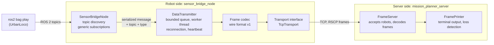

# robot_server_comm

A C++ ROS 2 package that sends the sensor data of a robot to a Mission Planner Server, reliably and without knowing the sensors in advance.

The node subscribes to every topic played from a rosbag (or to an explicit list), and a separate transmitter class streams the messages to the server over TCP. A small local server, included in the package, receives the data and prints it in the terminal.

Contents: [Dataset](#dataset) · [Architecture](#overall-software-architecture) · [Protocol and message format](#communication-protocol-and-message-format) · [Data handling](#data-handling-and-transmission-approach) · [Build and run](#building-and-running-the-package) · [Docker](#docker) · [Tests](#tests) · [Extending](#extending-the-package) · [Limits](#limits-and-next-steps)

## Dataset

| | |
|---|---|
| Source | [UrbanLoco](https://github.com/weisongwen/UrbanLoco) (Wen et al., ICRA 2020) |
| Dataset used | **HK-Data20190117** (Hong Kong, 17 January 2019, 5 min 22 s, 5.4 GiB, ROS 2 bag, 20 topics, 41 817 messages) |
| Download | [Dropbox folder linked from the UrbanLoco repository](https://www.dropbox.com/scl/fo/zrsmoddbq96t4go1wbxwp/AJw_DGVXng06DmLx9j9iQMs?rlkey=rk11n8tt62ejbg8mbixrm6quz&e=1&st=j7sy3izj&dl=0) |

I chose HK-Data20190117 rather than the 41.6 GB HK-Data20190426-2 given as an example: it is about seven times smaller and still has 20 topics from an IMU, a 3D LiDAR and two GNSS receivers. The package works with any UrbanLoco recording, or any other rosbag, without change. The rosbag is not stored in this repository.

This recording has no camera topic. The package does not depend on one: images are forwarded like any other message, the server decodes `sensor_msgs/msg/Image` and `sensor_msgs/msg/CompressedImage`, and the tests cover image messages and a 16 MB payload.

Topics of the recording, from `ros2 bag info`:

| Sensor | Topic | Message type | Messages | Rate |
|---|---|---|---|---|
| IMU (Xsens MTi 10) | `/imu/data` | `sensor_msgs/msg/Imu` | 31 808 | 100 Hz |
| 3D LiDAR (Velodyne HDL-32E) | `/velodyne_points_0` | `sensor_msgs/msg/PointCloud2` | 3 178 | 10 Hz |
| u-blox GNSS receiver, position | `/ublox_gps_node/fix` | `sensor_msgs/msg/NavSatFix` | 317 | 1 Hz |
| u-blox GNSS receiver, velocity | `/ublox_gps_node/fix_velocity` | `geometry_msgs/msg/TwistWithCovarianceStamped` | 317 | 1 Hz |
| GNSS position | `/navsat/fix` | `sensor_msgs/msg/NavSatFix` | 319 | 1 Hz |
| GNSS odometry | `/navsat/odom` | `nav_msgs/msg/Odometry` | 318 | 1 Hz |
| NovAtel SPAN-CPT receiver logs (4 topics) | `/novatel_data/bestpos`, `corrimudata`, `inscov`, `inspvax` | `novatel_oem7_msgs/msg/*` | about 320 each | 1 Hz |
| u-blox receiver logs (10 topics) | `/ublox_gps_node/aidalm`, `aideph`, `monhw`, `navclock`, `navposecef`, `navpvt`, `navsat`, `navstatus`, `rxmraw`, `rxmsfrb` | `ublox_msgs/msg/*` | 16 to 1 272 each | up to 4 Hz |

`ros2 bag play` only plays a topic when its message type is installed; otherwise it prints "Ignoring a topic" and skips it. The six standard topics always play. With `novatel_oem7_msgs` and `ublox_msgs` installed (`ros-jazzy-novatel-oem7-msgs`, `ros-jazzy-ublox-msgs`), 13 of the 14 NovAtel and u-blox topics play too, so 19 of the 20 topics in total. `/novatel_data/inscov` stays skipped: its type `INSCOV` no longer exists in the current `novatel_oem7_msgs` release. The node needs no change in any case: it forwards whatever the player publishes, including message types it was never compiled against.

No topic name and no message type is hard-coded in the node: both are read from the ROS graph when the bag starts playing.

**ROS 1 recordings.** `ros2 bag play` needs a ROS 2 bag (a folder with `metadata.yaml`). A recording delivered as a single ROS 1 `.bag` file is converted once with [rosbags](https://pypi.org/project/rosbags/):

```bash
pip install rosbags
rosbags-convert --src HK-Data20190117.bag --dst HK-Data20190117
```

## Overall software architecture



The package is split in layers, and each layer only knows the one below it through a small interface.

| Layer | Files | Responsibility | Depends on ROS |
|---|---|---|---|
| ROS node | `sensor_bridge_node.*`, `sensor_bridge_main.cpp` | Parameters, topic discovery, subscriptions, status logs | yes |
| Transmitter | `core/data_transmitter.*` | Queue, worker thread, connection management, statistics | no |
| Protocol | `protocol/frame*.{hpp,cpp}`, `crc32` | Wire format: encoding and stream decoding | no |
| Transport | `transport/transport.hpp`, `tcp_transport.*`, `transport_factory.*` | Moving bytes to the server | no |
| Local server | `server/*`, `mission_planner_server_main.cpp` | Receiving, checking and printing the data | no |

Four design decisions follow from this split:

1. **The node knows nothing about sockets, and the transmitter knows nothing about ROS.** The node hands over "bytes + topic name + type name". This is the separate class asked for in the assignment (`DataTransmitter`), and it is why everything below the node is unit tested without a ROS installation.
2. **Generic subscriptions.** The node uses `rclcpp::GenericSubscription`, which delivers messages still serialized. A new sensor topic, even with a message type the package has never seen, is forwarded without changing or rebuilding the code.
3. **One network thread.** ROS callbacks only copy the message into a queue. All socket work happens in the transmitter thread, so a slow or dead server can never block the ROS executor.
4. **One callback group per topic.** The node runs on a multi-threaded executor and every subscription has its own callback group. Topics are handled in parallel, so copying a 7 MB image does not delay the 100 Hz IMU, while the messages of one topic stay in order.

Repository layout:

```
robot_server_comm/
├── include/robot_server_comm/   public headers (core, net, protocol, server, transport)
├── src/                         implementation, node and server entry points
├── test/                        unit, end to end and node tests (GoogleTest)
├── launch/robot_server_comm.launch.py
├── config/sensor_bridge.yaml    node parameters
├── docker/entrypoint.sh
├── Dockerfile
├── CMakeLists.txt, package.xml
└── README.md
```

## Communication protocol and message format

### Why TCP with a small framing protocol

| Need | How TCP + framing answers it |
|---|---|
| Nothing lost or reordered while connected | TCP delivers an ordered, complete byte stream and retransmits lost packets |
| Messages from a few bytes (GNSS) to several megabytes (image, point cloud) | A stream has no datagram size limit, so no fragmentation code is needed |
| Know when the link is down | Connection oriented: failures show up as errors, completed by heartbeats and timeouts |
| No extra infrastructure | No broker to install (unlike MQTT), only one port on the server |
| Few dependencies, any CPU | POSIX sockets only, no third party library |

Alternatives I considered: UDP (lowest latency but no delivery guarantee and a 64 kB datagram limit), MQTT (good for telemetry and unstable links, but needs a broker and is not designed for multi megabyte payloads), gRPC or WebSocket (richer, but heavy dependencies for a one way sensor stream). They remain possible later because the transport is behind an interface, see [Extending the package](#extending-the-package).

TCP gives a stream of bytes, not messages, so each message is wrapped in a frame that says where it starts, where it ends and what it contains.

### Frame format (RSCP version 1)

All integers are big-endian (network byte order).

| Offset | Size | Field | Notes |
|---|---|---|---|
| 0 | 4 | Magic | ASCII `RSCP`, detects a stream that is not ours or out of sync |
| 4 | 1 | Version | `1`, a receiver refuses versions it does not know |
| 5 | 1 | Frame type | `1` DATA, `2` HELLO, `3` HEARTBEAT |
| 6 | 2 | Flags | bit 0: body CRC present |
| 8 | 8 | Sequence | per topic counter, a gap on the server means lost messages |
| 16 | 8 | Timestamp | UNIX time in nanoseconds when the robot took the message |
| 24 | 2 | Topic length T | |
| 26 | 2 | Type length M | |
| 28 | 4 | Payload length P | checked against a configurable maximum (64 MB by default) |
| 32 | 4 | Body CRC-32 | over topic + type + payload |
| 36 | 4 | Header CRC-32 | over bytes 0 to 35 |
| 40 | T | Topic | for example `/imu/data` |
| 40+T | M | Message type | for example `sensor_msgs/msg/Imu` |
| 40+T+M | P | Payload | the ROS message serialized in CDR |

Frame types:

- **HELLO**: first frame on every connection. The payload is the robot id.
- **DATA**: one sensor message.
- **HEARTBEAT**: sent when nothing else was sent for one second, so the server can tell a quiet robot from a dead one.

### Payload format: CDR

The payload is the message exactly as ROS 2 serialized it (CDR, the OMG standard used by DDS). I chose to forward it untouched instead of converting it to JSON or Protobuf:

- **No conversion cost.** A point cloud of more than a megabyte or a 1920 x 1200 image is never parsed or re-encoded on the robot.
- **Works for every message type**, including custom ones, with no per type code.
- **Portable.** CDR carries its own byte order flag and is readable from C++, Python, Java or Rust, so the server does not need ROS. The local server proves it: it decodes IMU, GNSS, odometry, velocity, point cloud and image messages with a small CDR reader (about 150 lines) and no ROS dependency.
- **Self describing enough.** Each frame carries the topic and the type name, so the server knows how to interpret the bytes.

The header is deliberately binary and fixed size rather than JSON: it is parsed with a few shifts, has no dependency, and its checksum is verified before the receiver waits for (or allocates memory for) the body. A corrupt length field can therefore not make the server wait for gigabytes.

## Data handling and transmission approach

**Topic selection.** With the default parameters the node looks at the ROS graph twice per second and subscribes to every topic that has a publisher, except ROS internals (`/rosout`, `/parameter_events`, `/clock`, hidden topics). The `topics` parameter restricts this to an explicit list. A topic whose message package is not installed is reported once and skipped, the others keep working. Discovery is periodic, so the messages a new topic publishes before the next discovery (at most half a second) are not forwarded.

**Quality of service.** By default (`qos_reliability: auto`) each subscription matches what the publishers of the topic offer, reliable if all of them are reliable and best effort otherwise. This avoids the classic silent failure of ROS 2, a subscription that never receives anything because its QoS is incompatible. The history depth (`qos_depth`, 50 by default) absorbs bursts while the node is busy.

**Before the node: DDS and large messages.** Between `ros2 bag play` and the node, messages travel over DDS, outside this package. With several megabytes per message, DDS can drop samples before they reach the node when the UDP receive buffer of Linux is too small, which is a known tuning point of ROS 2. The symptom is a per topic count on the server slightly lower than the count shown by `ros2 bag info`, with `lost=0` (nothing was lost between the node and the server). The fix is to raise the buffer before starting the nodes:

```bash
sudo sysctl -w net.core.rmem_max=67108864 net.core.rmem_default=67108864
```

**From callback to socket.**

1. The ROS callback of the topic applies the optional rate limit, then copies the serialized message into the transmitter queue (one memory copy, no parsing). Callbacks of different topics run in parallel.
2. The transmitter stamps the message with the time and a per topic sequence number.
3. The worker thread takes messages from the queue, builds the 40 byte header and writes header and payload with a single gather write (`sendmsg`), so large payloads are not copied again.

**Real time behaviour and bounded memory.** The queue is limited in messages (200) and in bytes (64 MB). When it is full, the **oldest** message is dropped: for live sensor data a fresh measurement is worth more than a stale one, and memory use stays bounded however long the outage lasts. Every drop is counted on the robot and visible on the server as a gap in the sequence numbers. On a constrained link, `topic_rate_limits` lowers the rate of chosen topics (for example the LiDAR) without touching the others.

**Connection management.**

- The socket is non-blocking and every wait has a timeout (connection, send), so no call can hang forever.
- A closed or reset connection is detected before the next send, a stalled server is detected by the send timeout, and an unplugged cable by TCP keep-alive and `TCP_USER_TIMEOUT`.
- After a failure the transmitter reconnects with exponential backoff (0.5 s, 1 s, 2 s... capped at 8 s) and announces itself again with HELLO.
- The message that was being sent when the link failed is kept and sent first after reconnection.
- The server disconnects a robot that stays silent for 5 seconds (no data and no heartbeat) and closes any connection that does not speak the protocol.

**Delivery guarantee.** While the link is up, messages arrive complete, in order and checked by CRC. During an outage the newest messages are kept up to the queue limits and delivered after reconnection, the older ones are dropped and counted. This is the right trade-off for sensor streams. Commands or mission critical events would need an application level acknowledgement, which the sequence numbers already prepare (see [Limits and next steps](#limits-and-next-steps)).

**Input validation.** Parameters are checked at start-up (port range, timeouts, QoS values, rate limit syntax) and the node stops with a clear message instead of running misconfigured. The decoder validates magic, version, frame type, lengths and both checksums. The CDR reader checks every read against the buffer size.

**Multi-architecture.** The code uses only standard C++17 and POSIX sockets, with no architecture specific compiler flag. The wire format is defined byte by byte and written with shifts, so it does not depend on the endianness, alignment or struct layout of the CPU. Integer widths are fixed (`uint32_t`, `uint64_t`). The Docker base image exists for amd64 and arm64.

## Building and running the package

Requirements: Ubuntu with ROS 2, `colcon` and `rosdep`, or Docker (see [Docker](#docker)). I developed and tested the package on ROS 2 Jazzy (Ubuntu 24.04, x86_64), natively and in Docker Desktop on Windows. The code only uses APIs that also exist in Humble, but I have not tested that distribution.

### Build and test

```bash
mkdir -p ~/ros2_ws/src && cd ~/ros2_ws/src
git clone https://github.com/surflabstack/robot_server_comm.git robot_server_comm
cd ~/ros2_ws
rosdep install --from-paths src --ignore-src -y
# Optional: message packages of the NovAtel and u-blox topics of the recording
sudo apt install ros-jazzy-ublox-msgs ros-jazzy-novatel-oem7-msgs
colcon build --packages-select robot_server_comm
source install/setup.bash

colcon test --packages-select robot_server_comm --event-handlers console_direct+
colcon test-result --verbose
```

### Run

Three terminals, each with `source ~/ros2_ws/install/setup.bash`.

```bash
# Terminal 1: the local Mission Planner Server
ros2 run robot_server_comm mission_planner_server --port 9000

# Terminal 2: the sensor bridge node, started with the launch file
ros2 launch robot_server_comm robot_server_comm.launch.py launch_server:=false

# Terminal 3: the rosbag
ros2 bag info /path/to/HK-Data20190117
ros2 bag play /path/to/HK-Data20190117 --delay 1
```

`--delay 1` makes the player wait one second after it has advertised its topics, so the node is subscribed to all of them before the first message is played.

Shorter variants:

```bash
# Server and node in one terminal
ros2 launch robot_server_comm robot_server_comm.launch.py

# Server, node and bag replay in one command
ros2 launch robot_server_comm robot_server_comm.launch.py bag:=/path/to/HK-Data20190117
```

To see the reconnection logic, stop the server with Ctrl+C while the bag is playing and start it again: the node reports the lost link, retries with increasing delays, reconnects and resumes.

### What the terminals show

Server, one line per received message (limited to one line per topic every 500 ms by default) and a statistics table every 5 seconds. Lines taken from a run with HK-Data20190117 in Docker on a laptop:

```
[SERVER] client #1 connected from 127.0.0.1:36348
[HELLO] client #1 is robot 'urbanloco_vehicle' (protocol v1)
[DATA] robot=urbanloco_vehicle topic=/imu/data type=sensor_msgs/msg/Imu seq=911 size=324 B latency=0.41 ms | stamp=1547714248.854880094 frame=/imu accel=[-0.001, -0.002, 0.098] m/s^2 gyro=[-0.002, 0.000, 0.011] rad/s
[DATA] robot=urbanloco_vehicle topic=/velodyne_points_0 type=sensor_msgs/msg/PointCloud2 seq=87 size=1.76 MB latency=16.01 ms | stamp=1547714248.459463936 frame=velodyne points=57765 (57765x1) point_step=32 B fields=x,y,z,intensity,ring data=1.76 MB
[DATA] robot=urbanloco_vehicle topic=/ublox_gps_node/fix type=sensor_msgs/msg/NavSatFix seq=5 size=128 B latency=15.32 ms | stamp=1547714249.294886663 frame=gps lat=22.3305344 lon=114.1795645 alt=5.75 m fix_status=0 service=3
[STATS] ---- last 5.1 s ---- total messages=1100 total data=172.18 MB lost=0
[STATS] urbanloco_vehicle /imu/data                    91.6 Hz     29.0 kB/s  received=971 lost=0
[STATS] urbanloco_vehicle /velodyne_points_0            9.2 Hz    16.19 MB/s  received=97 lost=0
```

Imu, NavSatFix, PointCloud2, Image, CompressedImage, Odometry and TwistWithCovarianceStamped payloads are decoded and summarized. Other types, such as the NovAtel and u-blox messages, are shown with their size and a hex preview. `latency` is the time between the robot taking the message and the server receiving it (meaningful when both clocks are synchronized, which is always the case on one machine).

Node: one `Forwarding` line per topic every 2 seconds (`Link down, buffering` while the server is unreachable) and a status line every 5 seconds with the link state, the number of messages sent, queued and dropped, and the rate of each topic.

### Launch arguments

| Argument | Default | Meaning |
|---|---|---|
| `server_host` | `127.0.0.1` | Address of the server |
| `server_port` | `9000` | TCP port of the server |
| `robot_id` | `urbanloco_vehicle` | Name announced to the server |
| `launch_server` | `true` | Start the local server in the same launch |
| `print_period_ms` | `500` | Server: minimum time between two printed messages of a topic, `0` prints all |
| `bag` | empty | Path of a rosbag to replay |
| `bag_rate` | `1.0` | Replay speed |
| `params_file` | `config/sensor_bridge.yaml` | Parameters of the node |
| `log_level` | `info` | Log level of the node |

### Node parameters

| Parameter | Default | Meaning |
|---|---|---|
| `protocol` | `tcp` | Transport, selected by name in the transport factory |
| `server_host`, `server_port` | `127.0.0.1`, `9000` | Server address |
| `robot_id` | `robot_1` | Name announced in HELLO |
| `topics` | empty | Topics to forward, empty means every topic that appears |
| `exclude_topics` | ROS internals | Never forwarded when `topics` is empty |
| `topic_rate_limits` | empty | Per topic limit, `"topic:max_hz"` |
| `discovery_period_s` | `0.5` | Period of the search for new topics |
| `qos_reliability` | `auto` | `auto`, `reliable` or `best_effort` |
| `qos_depth` | `50` | History depth of the subscriptions |
| `max_queue_messages` | `200` | Queue limit in messages |
| `max_queue_megabytes` | `64` | Queue limit in memory |
| `connect_timeout_ms`, `send_timeout_ms` | `2000` | Network timeouts |
| `reconnect_initial_delay_ms`, `reconnect_max_delay_ms` | `500`, `8000` | Backoff bounds |
| `heartbeat_period_ms` | `1000` | Idle time before a heartbeat |
| `enable_crc` | `true` | CRC-32 on every frame body |
| `status_period_s`, `log_period_s` | `5.0`, `2.0` | Terminal output of the node, `0` disables |

The local server has its own options, listed by `ros2 run robot_server_comm mission_planner_server --help`. It listens on `127.0.0.1` by default, so it is only reachable from the same machine.

## Docker

The Dockerfile installs the dependencies with `rosdep`, builds the package and runs the tests during the image build. The same commands work on Linux, and on Windows or macOS with Docker Desktop.

```bash
docker build -t robot_server_comm .

# Terminal 1: server + node (the folder containing the rosbag is mounted on /data)
docker run --rm -it --name rsc --shm-size=1g -v /path/to/bags:/data:ro robot_server_comm

# Terminal 2: replay the bag inside the same container
docker exec -it rsc /entrypoint.sh ros2 bag play /data/HK-Data20190117 --delay 1
```

Other uses:

```bash
# Everything in one command
docker run --rm -it --shm-size=1g -v /path/to/bags:/data:ro robot_server_comm \
  ros2 launch robot_server_comm robot_server_comm.launch.py bag:=/data/HK-Data20190117

# Another ROS 2 distribution (not tested)
docker build --build-arg ROS_DISTRO=humble -t robot_server_comm:humble .

# Image for PC and ARM computers
docker buildx build --platform linux/amd64,linux/arm64 -t robot_server_comm .
```

The image also installs the NovAtel and u-blox message packages, so `ros2 bag play` plays 19 of the 20 topics of HK-Data20190117 (`--build-arg DATASET_MSG_PACKAGES=` leaves them out). `--shm-size=1g` gives the DDS middleware enough shared memory for camera and point cloud messages (Docker allows only 64 MB by default). When cross-building under emulation, `--build-arg RUN_TESTS=false` skips the tests, which are slow on an emulated CPU. On a computer with little memory, `--build-arg MAKEFLAGS=-j1` compiles one file at a time.

## Tests

`colcon test` runs 8 GoogleTest programs and 6 style checkers.

| Test | What it checks |
|---|---|
| `test_frame_codec` | Wire format byte by byte, round trips, streams cut at any byte, corrupted header or payload, wrong version, oversized payload, CRC against the reference algorithm |
| `test_bounded_queue` | Order, drop-oldest policy on both limits, refusal of oversized items, blocking pop, two threads |
| `test_config_utils` | Parameter validation, rate limit parsing and behaviour, transport factory |
| `test_tcp_transport` | Real sockets on loopback: refused connection, ordered gather writes, 16 MB message, server closing the connection, server that stops reading (send timeout), reconnection |
| `test_data_transmitter` | With a scripted fake transport: HELLO first, ordering, retry of the failed message, drop-oldest during an outage, exponential backoff, heartbeats, invalid input, fast shutdown |
| `test_payload_summary` | CDR decoding against reference messages produced by an independent CDR implementation, both byte orders, every truncation of a message |
| `test_end_to_end` | Transmitter + TCP + server + printer on loopback: complete and ordered delivery of sensor sized streams, server restart, several robots, a client that does not speak the protocol, silent client, heartbeats |
| `test_sensor_bridge_node` | The ROS 2 node with real publishers and a real server in one process: topics of two different types are discovered, forwarded and decoded back to the original messages, an explicit topic list is respected, invalid parameters stop the node at start-up |
| `copyright`, `cpplint`, `uncrustify`, `lint_cmake`, `flake8`, `pep257` | ROS 2 coding style of the C++ sources, the CMake file and the launch file |

The first seven tests have no ROS dependency. Together with the core library and the server, they also build with plain CMake on a machine without ROS:

```bash
cmake -S . -B build && cmake --build build -j && ctest --test-dir build
```

## Extending the package

**A new sensor topic.** Nothing to do when `topics` is empty. Otherwise add its name to `topics`. No code change, no rebuild.

**A readable summary for a new message type on the server.** Register a decoder:

```cpp
printer.summarizer().register_decoder(
  "my_msgs/msg/Battery",
  [](const std::uint8_t * data, std::size_t size) {
    robot_server_comm::CdrReader reader(data, size);
    return "voltage=" + std::to_string(reader.read<float>());
  });
```

**A new communication protocol.**

1. Write a class that implements the 6 methods of `Transport` (`transport/transport.hpp`).
2. Register it: `TransportFactory::instance().register_transport("udp", creator);`
3. Select it with the parameter `protocol: "udp"`.

The node, the transmitter, the queue and the frame format stay unchanged. `test_data_transmitter` already runs the transmitter on a second implementation of the interface (an in-memory fake).

**Other ROS 2 nodes.** `DataTransmitter` has a three call API (`start`, `submit`, `stop`) and no ROS dependency, so another node (diagnostics, mission status, map updates) can own its own transmitter or share one. `SensorBridgeNode` is also registered as a component (`robot_server_comm::SensorBridgeNode`), so it can be loaded in a container next to other nodes of the robot:

```python
ComposableNodeContainer(
    name='robot_container', namespace='', package='rclcpp_components',
    executable='component_container',
    composable_node_descriptions=[
        ComposableNode(
            package='robot_server_comm',
            plugin='robot_server_comm::SensorBridgeNode',
            name='sensor_bridge',
            parameters=[{'server_host': '127.0.0.1', 'server_port': 9000}]),
    ])
```

## Limits and next steps

- **No encryption or authentication.** Acceptable for a local test server bound to `127.0.0.1`. A deployment over a real network needs TLS and a robot identity check, which fit behind the `Transport` interface.
- **One way.** The server does not send anything back. Acknowledgements for critical messages and commands from the server to the robot would be the next protocol version, the version byte and the sequence numbers are there for that.
- **Single queue.** A very large message (camera image) delays the small ones queued behind it by the time it takes to send. Per topic queues with priorities would remove that.
- **No compression.** Point clouds and raw images compress well. The flags field of the header has free bits to announce a compressed payload.

## License

Apache-2.0. The UrbanLoco dataset is distributed by its authors under CC BY-NC-SA 4.0.
